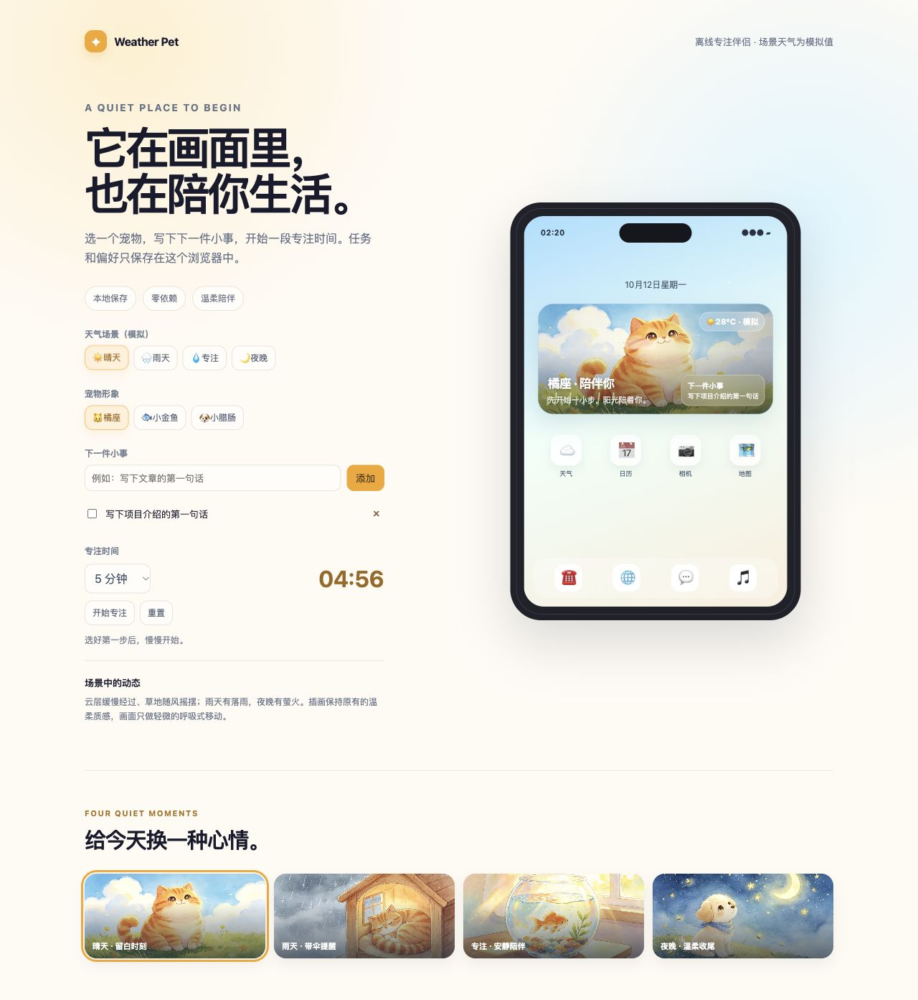

<div align="center">

# Weather Pet

**A quiet place to begin: pet scenes, tiny tasks and a focus timer.**

[中文](README.zh-CN.md) · [Quick start](#quick-start) · [Validation](docs/validation.md)

[](https://github.com/608tt/weather-pet/actions/workflows/test.yml)

[](LICENSE)

</div>

Weather Pet is a small offline browser app for starting one manageable task.
Choose a watercolor pet scene, write your next step and focus for 5, 25 or 45
minutes. Tasks, scene preferences and timer state stay in your browser.



[Mobile preview at 360px](docs/mobile.jpg)

## Features

- Four animated scenes: sunshine, rain, aquarium and night.
- Three pet companions, with scene and pet preferences saved locally.
- Add, complete and remove small tasks; the next task appears in the scene.
- A pause/resume timer based on wall-clock deadlines, so background tab delays
  do not silently slow down the countdown.
- Current local date/time, keyboard-accessible controls and reduced-motion support.
- No build step, server account, analytics, API key or external runtime dependencies.

Weather readings are **simulated scene values**, labeled in the interface.
The phone frame is a presentation; this release runs in a browser, with no native
iOS widget, operating-system calendar integration or live weather feed.

## Quick start

Open `index.html` directly, or serve it from localhost for consistent storage:

```bash
git clone https://github.com/608tt/weather-pet.git
cd weather-pet
python -m http.server 8000 --bind 127.0.0.1
```

Open **http://127.0.0.1:8000**. Select a scene, add one small task and start a
focus session. Use the checkbox to complete a task and the × button to remove it.
File-URL local storage behavior varies between browsers; localhost is recommended.

## How state works

State is stored under `weather-pet:v1` in local storage. Refreshing keeps your
tasks and timer. Pausing stores remaining time; running stores an absolute end
time. If storage is blocked, the app continues for the current page session and
shows a message. There is no cloud synchronization. Clearing site data removes
saved tasks; an operating-system clock change can affect an active timer.

## Tests

```bash
npm test
```

Node.js 22+ is only needed for development tests. Six regression tests cover
state validation, task limits, background suspension, pause/resume and formatting.
Browser checks also verified task creation, scene changes and state after reload.
See [validation](docs/validation.md).

## Origin and next steps

Built from the author's earlier Weather Pet concept and watercolor scene demo.
The pet artwork is AI-generated and labeled in the images; see [assets](docs/assets.md).
Possible next steps: import/export for tasks, an opt-in weather adapter, a
standalone web component and calendar integration with explicit user control.

MIT licensed. Small [contributions](CONTRIBUTING.md), accessibility improvements
and bug reports with a minimal reproducer are welcome.
